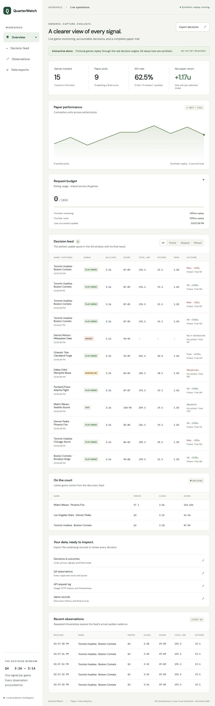
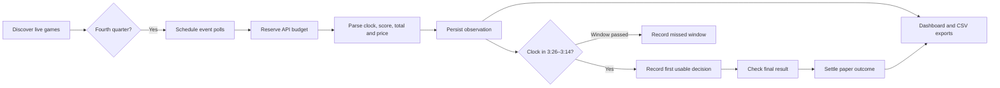

# QuarterWatch

**Live sports feed monitoring with adaptive polling, auditable decisions, and paper-trial analytics.**

QuarterWatch watches basketball games, concentrates API calls around a narrow fourth-quarter window, and records the evidence behind each signal. A Python collector and SQLite journal power a browser dashboard with decimal odds, overtime tracking, paper returns, and CSV exports.



## Try it in two minutes

Requires Python 3.10 or newer.

```sh
git clone https://github.com/Navdeep2424/quarterwatch.git
cd quarterwatch
python3 -m venv .venv
source .venv/bin/activate
python -m pip install -r requirements.txt
python quarterwatch.py --demo
```

Open **http://127.0.0.1:8765**. On Windows, activate the environment with `.venv\Scripts\activate`.

The demo replays fictional games through the same observation, classification, settlement, and export paths used by the live collector. The banner identifies synthetic data. A new game enters the decision window during each replay cycle. Use the feed filters to compare selected, skipped, and missed signals.

## What I built

- **Adaptive collection.** Discover games every 45 seconds, poll Q4 games more frequently as the decision window approaches, and switch to roughly one-second intervals near the trigger.
- **Concurrent I/O.** A thread pool separates event polling from discovery and result lookups. Slow requests can complete without holding the scheduler's main loop.
- **Two quota checks.** Reserve each request against a rolling local budget and respect the provider's remaining-call and reset headers.
- **A durable audit trail.** Store game snapshots, decisions, request outcomes, and settlements in SQLite with WAL journaling. A unique event key makes each decision idempotent.
- **A responsive operations dashboard.** Inspect live clocks, overtime, signal outcomes, cumulative paper returns, and CSV records. The collector runs independently of browser refreshes.
- **Reproducible evaluation.** Run a key-free synthetic replay and regression tests for clock jumps, missed windows, market parsing, settlement, and rate limits.

## How a signal is produced



The baseline rule calculates `points offered = live total − current combined score`. An Under becomes a paper selection when 19–22 points are offered and the score margin is at most eight. A final total below the captured line is a hit, above it is a miss, and equal is a push. Net paper return uses one unit per selected game and the captured decimal odds.

`MISSED` describes an unavailable decision window. The application preserves the observed clocks rather than inventing a quote between two snapshots. For example, repeated responses at 3:28 followed by 3:12 provide no quote inside 3:26–3:14. Skipped games with valid lines show their hypothetical result separately from the selected paper record.

## Run with a live feed

Live collection requires a BetsAPI account with access to the Bet365 endpoints. Set the token in your shell, then start a trial.

```sh
read -s BETSAPI_TOKEN
export BETSAPI_TOKEN
python quarterwatch.py --hours 24
```

Alternatively, pass a private token file with `--key-file /path/to/betsapi.key`. The supplied `.env.example` documents the variable name. The application reads environment variables directly.

| Option | Purpose |
| --- | --- |
| `--demo` | Run fictional games without provider requests |
| `--hours 24` | Set the duration of a new live trial |
| `--data-dir PATH` | Use a specific local data directory |
| `--port 8765` | Choose the localhost dashboard port |
| `--watch` | Follow saved snapshots and decisions in a terminal |
| `--key-file PATH` | Read a token from a private local file |

Live and demo databases use separate directories. By default, data lives in macOS Application Support, Windows Local App Data, or the Linux XDG data directory. An existing trial resumes its saved start time and duration. Use a different `--data-dir` for a new trial. Request logs stream to the terminal with response durations and sanitized endpoint names.

The app binds to `127.0.0.1` and is intended for a single local collector. Closing the process pauses collection. Keep the host awake and connected for a full trial.

## Engineering notes

The first field trial exposed several useful failure modes.

| Observation | Engineering response |
| --- | --- |
| The provider used nested arrays and compact market records | Parse event, market-group, market, and participant records explicitly |
| Full-game, team, and quarter totals shared similar labels | Keep the parent market context and reject unrelated or suspended markets |
| The feed repeated a clock before jumping across the full window | Record every snapshot and classify the missing window explicitly |
| Result responses used an internal ID different from the live ID | Join settlement using `bet365_id` |
| A synced Documents folder produced SQLite disk I/O errors | Use local application storage and retain recovery information |
| Overtime appeared as `OT 1` and `OT 2` | Parse overtime as periods five and six and render explicit OT labels |


## Development

```sh
python -m pip install -r requirements-dev.txt
ruff check .
ruff format --check .
python -m unittest discover -s tests -v
```

GitHub Actions runs formatting, lint, and tests on Python 3.10, 3.12, and 3.13. All tests use synthetic fixtures or mocked HTTP responses. See [architecture and tradeoffs](docs/architecture.md) for the scheduler, persistence model, and current boundaries.

## Repository map

```text
quarterwatch.py          Collector, scheduling, persistence, HTTP server and CLI
demo.py                  Fictional replay through the production decision path
web/                     Dashboard HTML, CSS and JavaScript
tests/                   Clock-window, parsing, quota and HTTP regression tests
docs/                    Architecture, field-trial notes and dashboard screenshot
.github/workflows/       Continuous integration
```

## Data and scope

The live adapter follows the Bet365 response format documented by [BetsAPI](https://b365api.com/bet365/). Provider access and refresh frequency depend on the service. A faster polling interval cannot force a new upstream quote, and quota limits or request timeouts can reduce sampling frequency. Games ending after the collection deadline may remain pending until a later result check is implemented.

This project evaluates a fixed paper-trial rule. It makes no claim that the rule predicts outcomes or produces a profitable strategy. The repository includes fictional replay fixtures. Credentials, personal logs, and collected game records are excluded. All screenshots and fixtures use fictional data.

Built by [Navdeep Rajpal](https://github.com/Navdeep2424).
